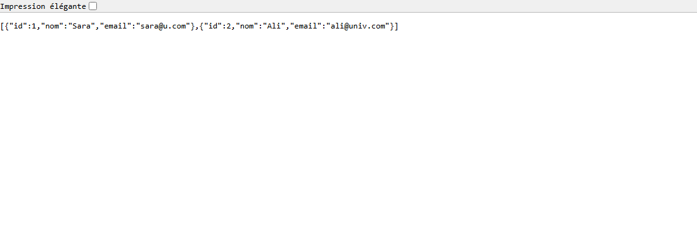
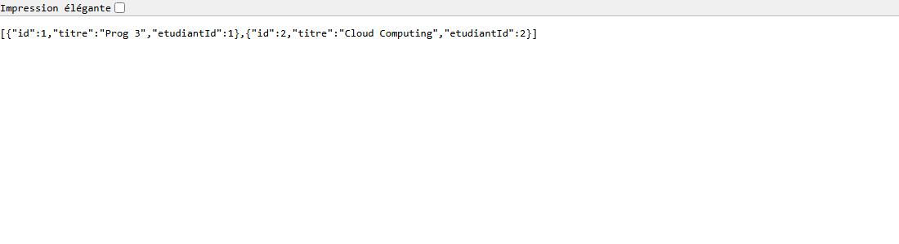
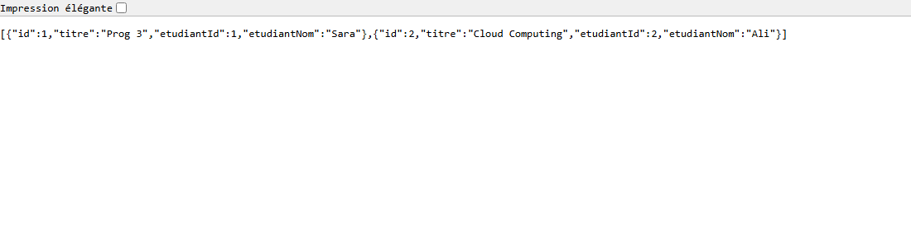

# Rapport TP2 — API REST distribuée avec Java

**Module :** Architecture Distribuée & Cloud Computing
**Sujet :** Deux microservices Spring Boot communiquant en REST
**Date :** 2026-11-05

---

## 1. Architecture

Deux microservices indépendants, chacun avec son propre stockage **en mémoire**,
communiquant en **HTTP/REST synchrone** via `RestTemplate`.

```
          Client (curl / navigateur)
               |                 |
        HTTP   |                 |  HTTP
               v                 v
   +-----------------+   +-------------------------+
   | ServiceEtudiants|   |      ServiceCours       |
   |   port 8081     |   |        port 8082        |
   |  CRUD /etudiants|   |  CRUD /cours            |
   |  (en mémoire)   |   |  + GET /cours/enrichis  |
   +-----------------+   +-------------------------+
            ^                        |
            |   GET /etudiants/{id}  |
            +------------------------+
             appel REST inter-services
             (RestTemplate, timeouts 2 s)
```

- **ServiceEtudiants (8081)** : `GET /etudiants`, `GET /etudiants/{id}`,
  `POST`, `PUT /{id}`, `DELETE /{id}`.
- **ServiceCours (8082)** : CRUD `/cours` (`id`, `titre`, `etudiantId`) plus
  `GET /cours/enrichis` qui, pour chaque cours, appelle ServiceEtudiants pour
  récupérer le nom de l'étudiant. Si l'étudiant est supprimé ou le service
  arrêté, le nom devient `"INCONNU"`.

---

## 2. Captures d'écran

**GET http://localhost:8081/etudiants**



**GET http://localhost:8082/cours**



**GET http://localhost:8082/cours/enrichis** (nom de l'étudiant résolu via ServiceEtudiants)



---

## 3. Résultats des 5 scénarios de test

| # | Scénario | Attendu | Obtenu |
|---|----------|---------|--------|
| 1 | `POST /etudiants` ×2, `GET /etudiants`, `GET /etudiants/99` | 201, 201, 200, 404 | ✅ 201, 201, 200, 404 |
| 2 | `POST /cours` ×2, `GET /cours` | 201, 201, 200 | ✅ 201, 201, 200 |
| 3 | `GET /cours/enrichis` | 200, cours 1 → `etudiantNom = "Sara"` | ✅ 200, cours 1 → "Sara" |
| 4 | `DELETE /etudiants/2` puis `GET /cours/enrichis` | 204, cours 2 → `"INCONNU"` | ✅ 204, cours 2 → "INCONNU" |
| 5 | ServiceEtudiants **arrêté**, `GET /cours/enrichis` | 200, tout → `"INCONNU"` (pas de 500) | ✅ 200, tout → "INCONNU" |

Détail complet des requêtes, codes HTTP et réponses JSON : voir
[`tests-local.md`](tests-local.md). **Les 5 scénarios passent.**

---

## 4. Réponses aux questions

### a) Que se passe-t-il si ServiceEtudiants est indisponible ?

ServiceCours **reste fonctionnel**. L'appel REST vers `/etudiants/{id}` échoue
(connexion refusée ou dépassement du *timeout* de 2 s), ce qui lève une
`ResourceAccessException`. Cette exception est **interceptée** dans
`/cours/enrichis` : le champ `etudiantNom` est alors mis à `"INCONNU"` avec une
remarque « ServiceEtudiants indisponible ». Le endpoint renvoie donc **200** et
non une erreur 500. Les opérations CRUD propres aux cours ne sont pas affectées :
le couplage est **partiel** (dégradation gracieuse), pas total.

### b) Comment rendre la communication plus résiliente ?

- **Timeouts** (déjà en place) : `connect` et `read` à 2 s sur le `RestTemplate`,
  pour ne jamais bloquer indéfiniment si l'autre service ne répond pas.
- **Retry** : réessayer 2-3 fois avec un délai croissant (*exponential backoff*)
  pour absorber les pannes passagères (ex. Spring Retry / Resilience4j `@Retry`).
- **Circuit breaker (Resilience4j)** : après trop d'échecs, « ouvrir le circuit »
  et renvoyer immédiatement un *fallback* `"INCONNU"` sans réessayer, le temps que
  ServiceEtudiants se rétablisse — cela évite d'aggraver la surcharge.
- **Cache** : mémoriser les derniers noms d'étudiants connus et les servir quand
  ServiceEtudiants est injoignable (données éventuellement périmées mais utiles).
- **Messagerie asynchrone** (Kafka, RabbitMQ) : ServiceEtudiants publierait des
  événements (étudiant créé / supprimé) et ServiceCours maintiendrait une copie
  locale. On supprime ainsi la dépendance synchrone à l'exécution : découplage
  fort, meilleure disponibilité.

---

## 5. Difficultés rencontrées

- **TLS bloqué par l'antivirus (Avast).** Au premier `mvn package`, Maven
  échouait avec `PKIX path building failed` sur `repo.maven.apache.org`. Cause :
  Avast intercepte le HTTPS et présente un certificat « Avast Web/Mail Shield
  Root » présent dans le magasin Windows mais **absent du truststore de Java**.
  Solution non-invasive : copie du truststore Java + import du certificat racine
  Avast, puis build via `MAVEN_OPTS=-Djavax.net.ssl.trustStore=...`. Aucun
  fichier du projet n'a été modifié.
- **Quoting JSON sous PowerShell.** Avec `curl.exe`, PowerShell supprime les
  guillemets du corps JSON (`{"nom":...}` devient invalide → HTTP 400). Résolu en
  envoyant le corps depuis un **fichier** : `curl.exe --data-binary @corps.json`.
- **Chemin contenant un espace.** « ARCHEICTEUR RESEAUX » cassait `java -jar`
  (« Unable to access jarfile ») ; il a fallu entourer le chemin du jar de
  guillemets.
- **Captures headless.** Lancer plusieurs instances de Chrome *headless* trop
  rapprochées faisait échouer les captures ; en les lançant une par une, les
  trois PNG ont été générés correctement.

Aucune modification de l'**architecture** ni de la **logique métier** n'a été
nécessaire : le code compilait et fonctionnait correctement une fois le problème
de certificat réseau contourné.

---

## 6. Conteneurisation (Docker)

À compléter après exécution avec Docker.
