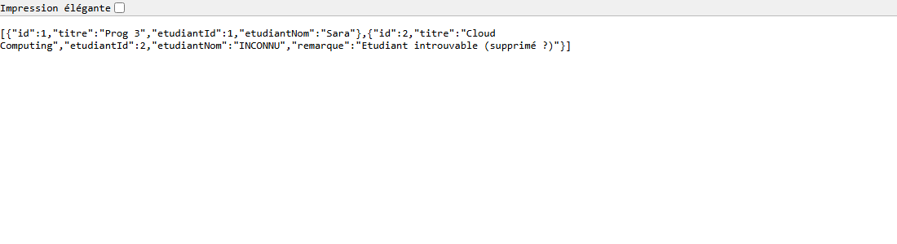
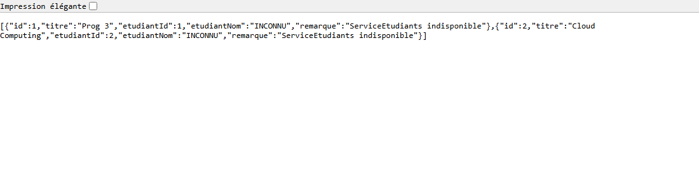

# Tests locaux — TP2 (API REST distribuée)

Tests exécutés sur la machine locale (hors Docker), le 2026-11-05.

- **ServiceEtudiants** : `java -jar target/ServiceEtudiants-1.0.0.jar` → port **8081**
- **ServiceCours** : `java -jar target/ServiceCours-1.0.0.jar` → port **8082**
- Outil : `curl.exe` (PowerShell). Les corps JSON sont envoyés via un fichier
  (`--data-binary @fichier.json`) pour éviter que PowerShell ne supprime les
  guillemets du JSON.

---

## Scénario 1 — CRUD Étudiants

| Requête | Attendu | Obtenu |
|---|---|---|
| `POST /etudiants {"nom":"Sara","email":"sara@u.com"}` | 201 | **201** |
| `POST /etudiants {"nom":"Ali","email":"ali@univ.com"}` | 201 | **201** |
| `GET /etudiants` | 200 | **200** |
| `GET /etudiants/99` | 404 | **404** |

```
### POST http://localhost:8081/etudiants
BODY> {"nom":"Sara","email":"sara@u.com"}
HTTP 201
RESP> {"id":1,"nom":"Sara","email":"sara@u.com"}

### POST http://localhost:8081/etudiants
BODY> {"nom":"Ali","email":"ali@univ.com"}
HTTP 201
RESP> {"id":2,"nom":"Ali","email":"ali@univ.com"}

### GET http://localhost:8081/etudiants
HTTP 200
RESP> [{"id":1,"nom":"Sara","email":"sara@u.com"},{"id":2,"nom":"Ali","email":"ali@univ.com"}]

### GET http://localhost:8081/etudiants/99
HTTP 404
RESP> {"timestamp":"...","status":404,"error":"Not Found","message":"Etudiant 99 non trouvé","path":"/etudiants/99"}
```

---

## Scénario 2 — CRUD Cours

| Requête | Attendu | Obtenu |
|---|---|---|
| `POST /cours {"titre":"Prog 3","etudiantId":1}` | 201 | **201** |
| `POST /cours {"titre":"Cloud Computing","etudiantId":2}` | 201 | **201** |
| `GET /cours` | 200 | **200** |

```
### POST http://localhost:8082/cours
BODY> {"titre":"Prog 3","etudiantId":1}
HTTP 201
RESP> {"id":1,"titre":"Prog 3","etudiantId":1}

### POST http://localhost:8082/cours
BODY> {"titre":"Cloud Computing","etudiantId":2}
HTTP 201
RESP> {"id":2,"titre":"Cloud Computing","etudiantId":2}

### GET http://localhost:8082/cours
HTTP 200
RESP> [{"id":1,"titre":"Prog 3","etudiantId":1},{"id":2,"titre":"Cloud Computing","etudiantId":2}]
```

---

## Scénario 3 — Vue enrichie (appel inter-services)

| Requête | Attendu | Obtenu |
|---|---|---|
| `GET /cours/enrichis` | 200, cours 1 → `etudiantNom = "Sara"` | **200**, cours 1 → **"Sara"** |

```
### GET http://localhost:8082/cours/enrichis
HTTP 200
RESP> [{"id":1,"titre":"Prog 3","etudiantId":1,"etudiantNom":"Sara"},
       {"id":2,"titre":"Cloud Computing","etudiantId":2,"etudiantNom":"Ali"}]
```

---

## Scénario 4 — Étudiant supprimé → "INCONNU"

| Requête | Attendu | Obtenu |
|---|---|---|
| `DELETE /etudiants/2` | 204 | **204** |
| `GET /cours/enrichis` | cours 2 → `"INCONNU"` | cours 2 → **"INCONNU"** |

```
### DELETE http://localhost:8081/etudiants/2
HTTP 204
RESP> (vide)

### GET http://localhost:8082/cours/enrichis
HTTP 200
RESP> [{"id":1,...,"etudiantNom":"Sara"},
       {"id":2,...,"etudiantNom":"INCONNU","remarque":"Etudiant introuvable (supprimé ?)"}]
```

Capture : 

---

## Scénario 5 — ServiceEtudiants arrêté → tout "INCONNU", pas de 500

| Requête | Attendu | Obtenu |
|---|---|---|
| (ServiceEtudiants arrêté) `GET /cours/enrichis` | 200, tout → `"INCONNU"`, pas de 500 | **200**, tout → **"INCONNU"** |

```
### GET http://localhost:8082/cours/enrichis   (ServiceEtudiants arrêté)
HTTP 200
RESP> [{"id":1,...,"etudiantNom":"INCONNU","remarque":"ServiceEtudiants indisponible"},
       {"id":2,...,"etudiantNom":"INCONNU","remarque":"ServiceEtudiants indisponible"}]
```

Capture : 

---

## Bilan

**Les 5 scénarios passent : attendu = obtenu.**

Le service de cours reste disponible (HTTP 200) même quand ServiceEtudiants est
supprimé un étudiant (404 interne) ou complètement arrêté (connexion refusée /
timeout). Dans les deux cas, le nom de l'étudiant est remplacé par `"INCONNU"`
grâce au `try/catch` du endpoint `/cours/enrichis` et aux timeouts de 2 s
configurés sur le `RestTemplate`.
